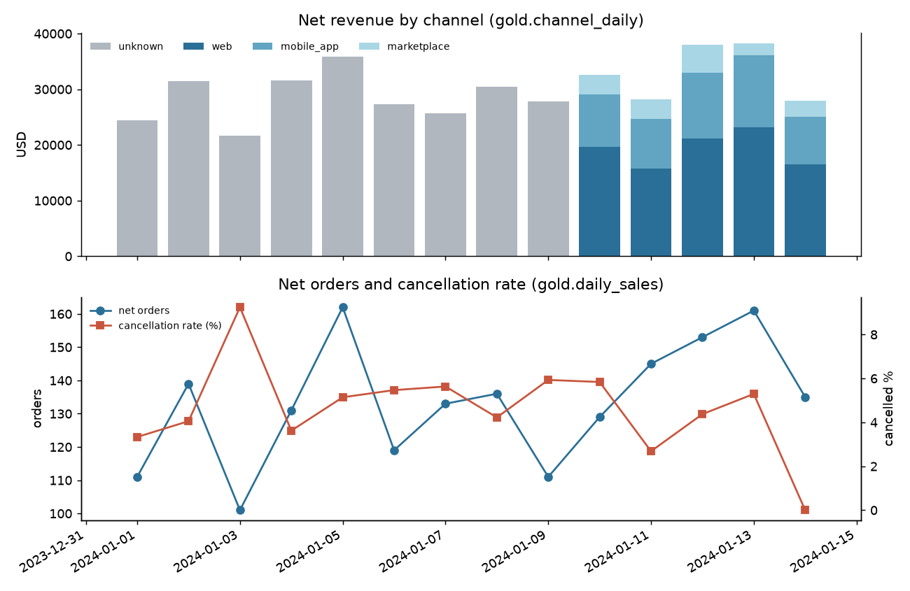
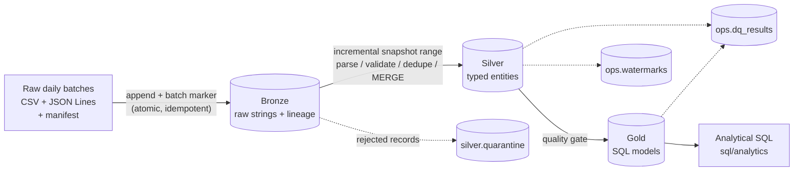
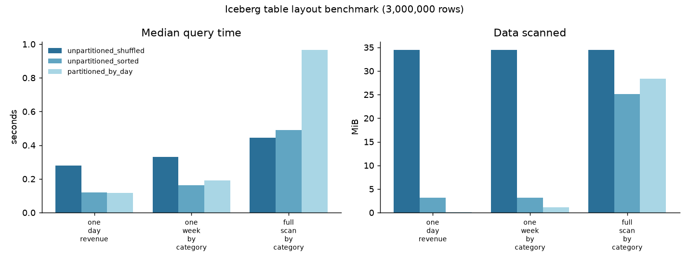

# IcebergFlow

A local-first data lakehouse built with **Apache Spark** and **Apache Iceberg**. IcebergFlow
ingests raw e-commerce exports, keeps them as an immutable Bronze record, turns them into
validated and deduplicated Silver tables, and publishes analytics-ready Gold models defined in
SQL. Every table is a real Iceberg table with Parquet data files, snapshots, time travel, and
schema and partition evolution. The whole pipeline runs on a laptop with free, open-source
software only.

The project centers on the parts of data engineering that are easy to get wrong:

* **Idempotency.** Every run can be repeated or resumed after a crash without duplicating data.
* **Incremental processing.** Silver reads only new Bronze rows, using Iceberg snapshot ranges.
* **Data quality.** Broken records are quarantined with reasons, and quality gates protect Gold.
* **Schema evolution.** New source columns flow through without rewriting history.
* **Evidence.** Behaviour is checked by integration tests against real Spark and Iceberg, and
  performance claims come from measured benchmarks.



## Contents

* [Technology stack](#technology-stack)
* [Architecture](#architecture)
* [Medallion layers](#medallion-layers)
* [Data model](#data-model)
* [Getting started](#getting-started)
* [Iceberg catalog](#iceberg-catalog)
* [Incremental processing and idempotency](#incremental-processing-and-idempotency)
* [Schema and partition evolution](#schema-and-partition-evolution)
* [Data quality and testing](#data-quality-and-testing)
* [Analytical queries](#analytical-queries)
* [Benchmarks](#benchmarks)
* [Project structure](#project-structure)
* [Limitations and future work](#limitations-and-future-work)

## Technology stack

| Area | Technology |
|---|---|
| Processing | Apache Spark 4.0.4 (PySpark), local mode |
| Table format | Apache Iceberg 1.10.1 (format v2), Hadoop catalog |
| Storage | Parquet with zstd compression on the local file system |
| Transformations | PySpark DataFrames and Spark SQL (`MERGE INTO`, SQL models) |
| Language | Python 3.12, SQL |
| Runtime | Java 17 (Spark 4.0 requires Java 17 or 21) |
| Quality and tests | Pytest (unit and Spark/Iceberg integration tests), Ruff |
| Packaging | `pyproject.toml`, Makefile |
| Charts | Matplotlib (optional, for benchmark and documentation charts) |

## Architecture



One command (`icebergflow run`) runs ingestion, incremental Silver processing, the Silver
quality gate, the Gold refresh and the Gold checks. Each step is also available as its own
command. See [docs/architecture.md](docs/architecture.md) for the component breakdown, catalog
layout and runtime details.

## Medallion layers

**Bronze: what arrived, unchanged.** Each source file is appended to its Bronze table with every
column kept as `STRING`, including values that will later fail validation. Unparseable JSON lines
are preserved in `_corrupt_record`. Lineage columns record the batch, the source file, the load
time and a SHA-256 record hash. A batch is rejected before commit if its row count differs from
the producer's manifest. Tables are partitioned by `_batch_id`.

**Silver: what is true.** Raw strings are parsed with ANSI-safe `try_*` casts and checked
against declarative rules: required fields, parseable timestamps, allowed status and channel
values, positive quantities, non-negative prices, valid emails, and referential integrity between
customers, orders, order lines and products. Records that fail any rule go to `silver.quarantine`
with *all* their reasons and the raw record. Valid records are deduplicated on the business key
(latest `updated_at` wins), then merged with `MERGE INTO`. A row is only replaced by a strictly
newer version, so late re-deliveries can never roll an order back to an earlier status.

**Gold: what the business asks.** Six models are plain SQL files in [`sql/gold`](sql/gold):
daily sales, sales by channel, product performance, monthly category mix, customer lifetime
summary and repeat-purchase cohorts. Each rebuild is one Iceberg commit. The two date-partitioned
models are refreshed only for the months touched by the latest run.

## Data model

| Table | Grain | Key |
|---|---|---|
| `silver.customers` | customer (latest version) | `customer_id` |
| `silver.products` | product (latest version) | `product_id` |
| `silver.orders` | order (latest status), partitioned by `days(order_ts)` | `order_id` |
| `silver.order_items` | order line | `order_id, line_number` |
| `gold.daily_sales` | order date | `order_date` |
| `gold.channel_daily` | order date and channel | `order_date, channel` |
| `gold.product_performance` | product | `product_id` |
| `gold.category_monthly` | month and category | `order_month, category` |
| `gold.customer_summary` | customer | `customer_id` |
| `gold.repeat_purchase_cohorts` | month of first order | `cohort_month` |

Net revenue counts orders whose current status is `placed`, `shipped` or `delivered`.
Cancelled and returned orders are reported separately. Full definitions:
[data model and transformation rules](docs/data_model.md) and the
[data dictionary](docs/data_dictionary.md).

### Data source and license

The data is **synthetic** and generated locally by
[`icebergflow.datagen`](src/icebergflow/datagen.py) with a fixed random seed (`42` by default).
The same settings reproduce the files byte for byte. The generator simulates a small online shop
with customer sign-ups and profile changes, price changes, order lifecycles (placed, shipped,
delivered, cancelled, returned), multi-line baskets and a minority of loyal repeat buyers. It
deliberately injects defects (missing and unknown keys, malformed timestamps, invalid statuses,
negative quantities, null prices, malformed emails, duplicates and late re-sent events) and
records each one in the batch manifest. Tests can therefore assert that every defect is caught.
From a configurable date, orders gain two new attributes (`channel`, `coupon_code`) to exercise
schema evolution. No third-party data is involved; everything is covered by this repository's
MIT license. A three-day sample is committed in [`data/sample`](data/sample) for inspection.
Assumptions and limitations of the generated data are listed in
[docs/data_model.md](docs/data_model.md#source-data).

## Getting started

### Prerequisites

* Python 3.12 or newer
* A JDK 17 or 21. Set `JAVA_HOME` or put `java` on `PATH`. On Windows, the JDK's `javac` is used
  once during setup.
* Internet access once, to install Python packages and download the Iceberg runtime jar (about
  47 MB) from Maven Central

No cloud account, database server or paid service is required.

### Install and run

```bash
python -m venv .venv
source .venv/bin/activate            # Windows: .venv\Scripts\activate
pip install -e ".[dev]"

icebergflow setup                    # download + checksum-verify the Iceberg jar (Windows: also builds the file system shim)
icebergflow generate --days 14 --schema-v2-from 2024-01-10
icebergflow run                      # Bronze -> Silver -> quality gate -> Gold -> Gold checks
```

On the development laptop described in [Benchmarks](#benchmarks), a clean `icebergflow run` over
the 14 generated batches takes about 84 seconds. A second run finds no new batches, reads
nothing from Bronze and leaves Gold untouched:

```text
INFO icebergflow.pipeline: pipeline finished affected_months=1 bronze_batches_ingested=56 silver_modes=full silver_rows_merged=6670
INFO icebergflow.pipeline: silver unchanged, gold is up to date
INFO icebergflow.pipeline: pipeline finished affected_months=0 bronze_batches_ingested=0 silver_modes=up_to_date silver_rows_merged=0
```

### Command reference

| Command | Purpose |
|---|---|
| `icebergflow setup` | Fetch runtime jars into `jars/` |
| `icebergflow generate [--days N] [--seed N] [--schema-v2-from DATE]` | Write synthetic batches to `data/raw` |
| `icebergflow ingest [--batch ID ...]` | Load batches into Bronze |
| `icebergflow silver [--full-refresh]` | Update Silver from Bronze |
| `icebergflow gold [--model NAME ...]` | Rebuild Gold models |
| `icebergflow run [--batch ID ...] [--full-refresh] [--skip-quality]` | Full pipeline |
| `icebergflow quality [--suite silver\|gold\|all]` | Run checks and print results (exit code 1 on errors) |
| `icebergflow query [NAME] [--list]` | Run an analytical query |
| `icebergflow snapshots TABLE` | Show a table's snapshot history |
| `icebergflow evolve-partition TABLE TRANSFORM` | Add a partition field |

The Makefile wraps the common flows: `make install setup generate run test lint benchmark`.

### Configuration

All settings are optional environment variables (see [`.env.example`](.env.example)):
`ICEBERGFLOW_RAW_DIR`, `ICEBERGFLOW_WAREHOUSE_DIR`, `ICEBERGFLOW_JARS_DIR`, `ICEBERGFLOW_SQL_DIR`,
`ICEBERGFLOW_CATALOG`, `ICEBERGFLOW_SPARK_MASTER`, `ICEBERGFLOW_DRIVER_MEMORY`,
`ICEBERGFLOW_SHUFFLE_PARTITIONS`, `ICEBERGFLOW_LOG_LEVEL` and `ICEBERGFLOW_LOG_FORMAT`
(`text` or `json`). Paths are relative to the working directory, so run commands from the
repository root. The project needs no credentials.

### Windows

Spark's Hadoop layer normally needs `winutils.exe` on Windows, a binary that Apache does not
publish. IcebergFlow avoids it: on Windows, `icebergflow setup` compiles a small Hadoop
`LocalFileSystem` subclass from the bundled Java source with your JDK, and the Spark session uses
it for local files. No `HADOOP_HOME` is needed. Details are in
[docs/architecture.md](docs/architecture.md#windows-support-without-winutilsexe). Everything in
this repository, including tests and benchmarks, was developed and run on Windows 10 this way.

## Iceberg catalog

IcebergFlow registers an Iceberg **Hadoop catalog** named `lakehouse` as Spark's default catalog,
with its warehouse in `./warehouse`, so tables are addressed as `bronze.orders`,
`silver.orders` and so on. The catalog is a directory tree: each table holds Parquet data files
and a metadata folder with versioned `vN.metadata.json` files, manifest lists and manifests. The
Iceberg SQL extensions are enabled for `MERGE INTO`, `UPDATE`, partition evolution DDL and
stored procedures.

```text
$ icebergflow snapshots bronze.orders
+-----------------------+-------------------+-------------------+---------+----------+-------------+-------------+
|committed_at           |snapshot_id        |parent_id          |operation|batch_id  |added_records|total_records|
+-----------------------+-------------------+-------------------+---------+----------+-------------+-------------+
|2026-10-26 12:37:48.253|7669327480928538589|NULL               |append   |2024-01-01|128          |128          |
|2026-10-26 12:37:48.709|8151679875795268000|7669327480928538589|append   |2024-01-02|221          |349          |
|2026-10-26 12:37:49.163|3777600120899115359|8151679875795268000|append   |2024-01-03|296          |645          |
...
|2026-10-26 12:37:54.129|994014915883190970 |8729998916926745895|append   |2024-01-14|463          |5275         |
+-----------------------+-------------------+-------------------+---------+----------+-------------+-------------+
```

Time travel and rollback work as standard Iceberg SQL:

```sql
SELECT count(*) FROM bronze.orders VERSION AS OF 8151679875795268000;   -- state after batch 2024-01-02
CALL lakehouse.system.rollback_to_snapshot('bronze.orders', 8151679875795268000);
```

A Hadoop catalog suits a single local writer. Switching to a REST, JDBC or Hive catalog only
changes the catalog properties in [`lakehouse/spark.py`](src/icebergflow/lakehouse/spark.py).

## Incremental processing and idempotency

* **Bronze:** each append commits the batch id as a snapshot property (`icebergflow.batch-id`)
  *in the same atomic commit as the data*. Reruns skip batches already present in the table's
  current lineage. Crashes leave either the whole batch or none of it. Rolled-back batches are
  reloaded.
* **Silver:** `ops.watermarks` stores the last Bronze snapshot each Silver table has processed.
  The next run reads only rows appended since then, with an Iceberg incremental append scan
  (`start-snapshot-id` / `end-snapshot-id`). After a rollback or a non-append change in Bronze,
  it falls back to a full read. Quarantine and Silver merges are idempotent, so a crash before
  the watermark update just re-reads the same range.
* **Gold:** date-partitioned models are refreshed for affected months only, via dynamic partition
  overwrite. The other models rebuild in a single commit.

The integration tests prove that processing the batches one by one gives *exactly* the same
Silver and Gold content as a full refresh, and that recovery from a simulated crash converges to
the same state. The full design is in [docs/processing_strategy.md](docs/processing_strategy.md).

## Schema and partition evolution

When the order feed adds `channel` and `coupon_code` (from `--schema-v2-from`), the next run
evolves the tables in place:

```text
INFO icebergflow.ingestion.bronze: evolved table schema added=channel,coupon_code table=bronze.orders
INFO icebergflow.transformations.silver: evolved table schema added=channel,coupon_code table=silver.orders
```

* Bronze adds new source columns automatically and rejects column names that are not lower snake
  case. Silver adds the columns declared in code. No data file is rewritten, and older rows read
  the new columns as NULL. Gold reports pre-v2 orders under channel `unknown`.
* SQL time travel (`VERSION AS OF`) returns a snapshot's *original* schema. The tests also show
  that the DataFrame option `snapshot-id` projects the *current* schema instead.
* `icebergflow evolve-partition silver.order_items "bucket(8, order_id)"` changes the partition
  spec without touching existing files. The tests verify that both specs coexist, that all rows
  remain readable, and that new files are pruned by `order_id` filters.

## Data quality and testing

**Quality checks** are declared in [`quality/suite.py`](src/icebergflow/quality/suite.py) and
compiled to SQL that counts violating rows:

* uniqueness of keys, not-null constraints and accepted values;
* referential integrity through anti-joins;
* row-level business rules (`quantity > 0`, `line_amount` formula, `order_date = to_date(order_ts)`);
* cross-layer reconciliation, for example Gold net revenue equal to Silver line amounts of net
  orders, in every Gold model;
* a warning if quarantined records exceed 10 % of an entity.

The Silver suite (29 checks) gates Gold; the Gold suite (16 checks) runs after the refresh.
Results go to `ops.dq_results`. On the default dataset all 45 checks pass, and the quarantine
holds 43 orders, 171 order lines, 8 customer updates and 2 product updates.

**Automated tests** use Pytest and are split by what they need:

| Suite | Path | Needs | Covers |
|---|---|---|---|
| Unit | `tests/unit` | Python only | config, logging, generator determinism and defects, batch discovery, Spark/catalog configuration, check SQL, query catalog, benchmark report |
| Integration | `tests/integration` | JDK + `icebergflow setup` | Iceberg tables, Parquet files, snapshots, time travel, rollback, pruning metrics; Bronze idempotency and recovery; every Silver rule; Gold values against hand-computed answers; cross-layer reconciliation; incremental equals full refresh; crash recovery; schema and partition evolution; quality gates; all analytical queries |

```bash
pytest tests/unit            # seconds
pytest tests/integration     # starts one local Spark session; about 13 minutes on the benchmark laptop
pytest                       # everything
ruff check . && ruff format --check .
```

Integration tests fail with an explicit message, rather than being skipped, if the runtime jars
are missing. Each test gets a freshly emptied lakehouse in a temporary directory, so tests never
touch `./warehouse`.

## Analytical queries

Nine queries in [`sql/analytics`](sql/analytics) each answer a business question stated on
their first line:

```text
$ icebergflow query --list
category_mix             How does each category contribute to monthly net revenue?
channel_mix              Which sales channels drive net revenue, and how often are coupons used on each?
cohort_retention         What share of each monthly cohort placed a second order, and how fast?
quarantine_report        Which data defects were rejected, in which source batches, and how often?
repeat_customer_value    How much more are repeat customers worth than one-time buyers?
revenue_by_country       Which countries bring the most buyers and revenue, and how loyal are they?
revenue_trend            How is daily net revenue trending, smoothed over a 7-day window?
top_customers            Who are the ten most valuable customers and how quickly did they come back?
top_products             Which ten products earn the most net revenue, and how much of their category do they carry?
```

Example ([`repeat_customer_value.sql`](sql/analytics/repeat_customer_value.sql)) on the default
dataset:

```sql
SELECT
    CASE WHEN is_repeat_customer THEN 'repeat' ELSE 'one_time' END AS segment,
    COUNT(*) AS customers,
    CAST(AVG(order_count) AS DECIMAL(8, 2)) AS avg_orders,
    CAST(AVG(lifetime_revenue) AS DECIMAL(12, 2)) AS avg_lifetime_revenue,
    CAST(AVG(avg_order_value) AS DECIMAL(12, 2)) AS avg_order_value,
    CAST(SUM(lifetime_revenue) / SUM(SUM(lifetime_revenue)) OVER () AS DECIMAL(6, 4))
        AS revenue_share
FROM gold.customer_summary
WHERE order_count > 0
GROUP BY CASE WHEN is_repeat_customer THEN 'repeat' ELSE 'one_time' END
ORDER BY segment DESC
```

```text
+--------+---------+----------+--------------------+---------------+-------------+
|segment |customers|avg_orders|avg_lifetime_revenue|avg_order_value|revenue_share|
+--------+---------+----------+--------------------+---------------+-------------+
|repeat  |296      |5.97      |1346.63             |223.73         |0.9470       |
|one_time|99       |1.00      |225.42              |225.42         |0.0530       |
+--------+---------+----------+--------------------+---------------+-------------+
```

```text
$ icebergflow query channel_mix
+-----------+----------+-----------+-------------+---------------+-----------+
|channel    |net_orders|net_revenue|revenue_share|avg_order_value|coupon_rate|
+-----------+----------+-----------+-------------+---------------+-----------+
|unknown    |1143      |256114.93  |0.6085       |224.07         |0.0000     |
|web        |404       |96404.10   |0.2290       |238.62         |0.1609     |
|mobile_app |247       |51486.21   |0.1223       |208.45         |0.1741     |
|marketplace|72        |16913.28   |0.0402       |234.91         |0.1806     |
+-----------+----------+-----------+-------------+---------------+-----------+
```

## Benchmarks

[`benchmarks/run_benchmarks.py`](benchmarks/run_benchmarks.py) runs in a throwaway warehouse
and reports the median of five runs after a warm-up, together with Iceberg's own scan metrics.
These are measured numbers from an Intel Core i5-9300H laptop (8 logical CPUs, 7.9 GB RAM,
Windows 10, Spark `local[*]`). Raw results:
[`benchmarks/results/latest.json`](benchmarks/results/latest.json).

**Table layout, 3,000,000 rows over 182 days:**

| Layout | One-day query | Data scanned | One-week query | Full scan |
|---|---:|---:|---:|---:|
| Unpartitioned, shuffled order | 0.280 s | 13/13 files, 34.5 MiB | 0.332 s | 0.445 s |
| Unpartitioned, sorted by time | 0.121 s | 1/10 files, 3.1 MiB | 0.163 s | 0.490 s |
| Partitioned by `days(order_ts)` | 0.118 s | 1/182 files, 0.2 MiB | 0.191 s | 0.967 s |

**Silver after one new batch, 30 batches in Bronze:** incremental 7.9 s (2,263 rows read)
versus full refresh 13.3 s (62,252 rows read).



What the numbers show: pruning depends on how data is clustered, not only on partitioning.
Daily partitions cut the bytes read for a one-day query by about 170x but made full scans about
twice as slow, because the table holds 182 small files. Incremental processing reads 3.6 % of
Bronze but is only about 1.7x faster at this small scale, because fixed per-commit overhead
dominates. Methodology and interpretation: [docs/performance.md](docs/performance.md).

## Project structure

```text
icebergflow/
├── src/icebergflow/
│   ├── cli.py                  # `icebergflow` command
│   ├── config.py               # environment-driven settings
│   ├── logging_config.py       # text/JSON structured logging
│   ├── datagen.py              # deterministic synthetic source data
│   ├── pipeline.py             # end-to-end orchestration and quality gates
│   ├── ingestion/              # batch discovery, Bronze loads, schema drift handling
│   ├── transformations/        # Silver specs + processing, Gold model runner
│   ├── quality/                # check builders and suites
│   ├── analytics/              # analytical query catalog
│   └── lakehouse/              # Spark session, catalog, snapshots, watermarks, metrics, runtime jars
├── sql/
│   ├── gold/                   # Gold models (one SELECT per file)
│   └── analytics/              # business questions
├── tests/
│   ├── unit/                   # no JVM required
│   └── integration/            # real Spark + Iceberg
├── benchmarks/                 # benchmark runner, report renderer, measured results
├── scripts/render_charts.py    # documentation chart from Gold tables
├── data/sample/                # three committed sample batches
├── docs/                       # architecture, data model, dictionary, processing, performance
├── Makefile, pyproject.toml
```

## Limitations and future work

* **Single node.** Spark runs in local mode and the Hadoop catalog assumes one writer on a local
  file system. A multi-writer deployment would use a REST or JDBC catalog and object storage.
* **Synthetic data.** The generator is intentionally simple: no seasonality or time zones, and
  order lifecycles are truncated at the end of the range (the last day shows no cancellations).
* **Quarantine is terminal.** Rejected records are kept for inspection, but there is no automated
  replay once a late-arriving parent record appears. A reprocessing command for quarantined
  records would be the next step.
* **Gold incremental scope.** Only the date-partitioned models refresh by partition; lifetime and
  cohort models rebuild fully, which is cheap here but would need incremental logic at scale.
* **No table maintenance yet.** Snapshot expiration, orphan-file cleanup and compaction
  (`expire_snapshots`, `remove_orphan_files`, `rewrite_data_files`) are not scheduled. The
  benchmark shows where compaction would pay off.
* **Bronze is append-only.** A corrected batch must be delivered under a new batch id.

## License

[MIT](LICENSE)
