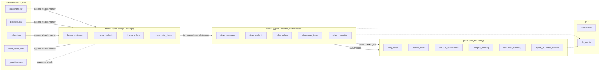

# Architecture

IcebergFlow is a single-node, local-first lakehouse. Apache Spark runs in local mode inside the
Python process that drives it. Every table is an Apache Iceberg table stored as Parquet files in a
directory on local disk. No servers, cloud services or databases are involved.



## Components

| Package | Responsibility |
|---|---|
| `icebergflow.datagen` | Deterministic synthetic source batches with injected defects |
| `icebergflow.ingestion` | Batch discovery, manifest checks, Bronze appends with snapshot markers, Bronze schema evolution |
| `icebergflow.transformations.silver` | Parsing, validation, referential integrity, quarantine, deduplication, `MERGE INTO`, incremental reads |
| `icebergflow.transformations.gold` | Runs the SQL models in `sql/gold`, full or month-partition refresh |
| `icebergflow.quality` | Declarative checks compiled to SQL, results table, pipeline gate |
| `icebergflow.analytics` | Catalog and runner for the business questions in `sql/analytics` |
| `icebergflow.lakehouse` | Spark session, catalog helpers, snapshots and lineage, watermarks, scan metrics, runtime jars |
| `icebergflow.pipeline` | End-to-end orchestration used by `icebergflow run` |

## Runtime and versions

| Component | Version | Notes |
|---|---|---|
| Python | 3.12+ | developed with 3.12.10 |
| PySpark | 4.0.4 | pinned in `pyproject.toml` |
| Apache Iceberg | 1.10.1 | `org.apache.iceberg:iceberg-spark-runtime-4.0_2.13` |
| Java | 17+ | Spark 4.0 requires Java 17 or 21; developed with Temurin 17.0.20 |
| Table format | Iceberg format version 2 | Parquet data files, zstd compression |

The Iceberg runtime jar is not resolved through `spark.jars.packages`. `icebergflow setup`
downloads it once from Maven Central into `jars/` and verifies it against the SHA-1 checksum
published next to the artifact. The session factory then places it on the driver classpath.
After that, runs are fully offline and the exact binary in use is pinned.

## Iceberg catalog

The project uses Iceberg's **Hadoop catalog** under the name `lakehouse`, registered as Spark's
default catalog. Queries can therefore refer to tables as `silver.orders` instead of
`lakehouse.silver.orders`.

```properties
spark.sql.extensions                 = org.apache.iceberg.spark.extensions.IcebergSparkSessionExtensions
spark.sql.catalog.lakehouse          = org.apache.iceberg.spark.SparkCatalog
spark.sql.catalog.lakehouse.type     = hadoop
spark.sql.catalog.lakehouse.warehouse= file:///<project>/warehouse
spark.sql.defaultCatalog             = lakehouse
spark.sql.session.timeZone           = UTC
```

A Hadoop catalog keeps no state outside the warehouse directory. Each table is a folder:

```
warehouse/silver/orders/
├── data/
│   └── order_ts_day=2024-01-05/00000-...parquet   # hidden partitioning: days(order_ts)
└── metadata/
    ├── v2.metadata.json         # schema, partition specs, snapshot list
    ├── version-hint.text        # pointer to the current metadata file
    ├── snap-<id>-...avro        # manifest list per snapshot
    └── <uuid>-m0.avro           # manifests: data files with column statistics
```

A commit writes a new `vN.metadata.json` and atomically moves the version pointer forward. That is
safe for a single writer on a local file system, which is the scope of this project. For
concurrent writers or object storage, the same code works with a REST, JDBC or Hive catalog by
changing the `spark.sql.catalog.lakehouse.*` properties in
[`lakehouse/spark.py`](../src/icebergflow/lakehouse/spark.py).

The SQL extensions enable `MERGE INTO`, `UPDATE`, `ALTER TABLE ... ADD PARTITION FIELD` and stored
procedures such as `rollback_to_snapshot`. All of these are used in the pipeline or the tests.

## Windows support without winutils.exe

Hadoop's local file system shells out to `winutils.exe` on Windows to set POSIX permissions and to
read file ownership. Apache Hadoop does not ship that binary. Rather than depending on third-party
builds, `icebergflow setup` compiles a small Hadoop `LocalFileSystem` subclass
([`PermissionlessLocalFileSystem.java`](../src/icebergflow/lakehouse/resources/PermissionlessLocalFileSystem.java))
with the local JDK against Spark's own Hadoop client jars. On Windows only, the session registers
it for the `file://` scheme. It skips permission and ownership calls, which have no meaning for a
single-user local warehouse, and reports file status from `java.io.File`. Linux and macOS use
Hadoop's standard implementation.

## Logging

Python code logs through the standard `logging` module, configured in
[`logging_config.py`](../src/icebergflow/logging_config.py). Structured fields passed with
`extra={...}` are rendered as `key=value` pairs, or as JSON with `ICEBERGFLOW_LOG_FORMAT=json`.
Spark and Iceberg use log4j2 with a packaged
[configuration](../src/icebergflow/lakehouse/resources/log4j2.properties) that keeps the console
at WARN level and silences warnings that are expected in local mode.
