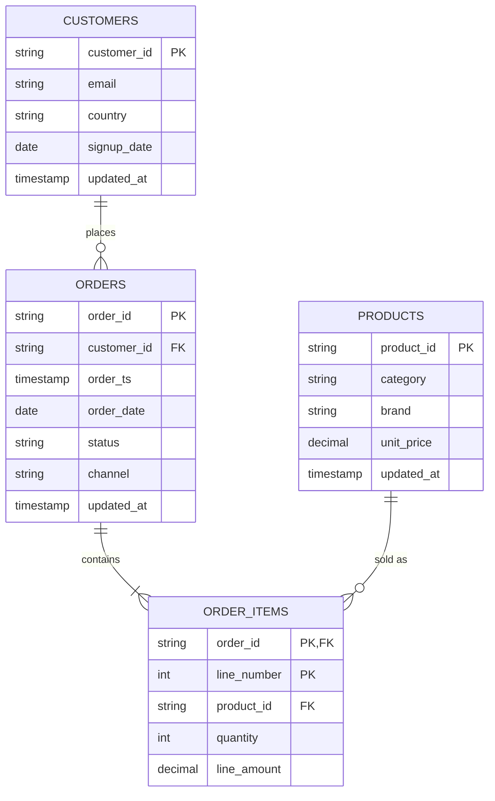

# Data model

## Source data

All data is synthetic, produced by [`icebergflow.datagen`](../src/icebergflow/datagen.py) with
Python's `random.Random` seeded from a fixed value (default `42`). The same configuration
reproduces the files byte for byte; a unit test checks this. No external dataset is used, so
there are no licensing constraints beyond this repository's MIT license.

The generator models a small online shop exporting one batch per day:

* **Customers**: 300 on the first day, 12 new sign-ups per day, and about 2 % of existing
  customers updated per day. A minority of customers is weighted to buy far more often, which
  creates repeat-purchase behaviour.
* **Products**: 80 products across 8 categories and 6 brands. About 2 % change price per day.
* **Orders**: around 150 per day (±20 %). Each order follows a lifecycle:
  `placed → shipped → delivered`, with about 5 % cancelled the next day and about 4 % returned
  3 to 7 days after delivery. Every status change is exported again as a full order record with
  a newer `updated_at`.
* **Order lines**: 1 to 4 per order, using the product's price on the order day and an occasional
  10 % or 20 % discount.

Defects injected on purpose (rates configurable, all counted in `_manifest.json`):

| Entity | Defect | Expected Silver reason |
|---|---|---|
| orders | `customer_id` missing | `missing_customer_id` |
| orders | `customer_id` not a known customer | `unknown_customer` |
| orders | `order_ts` in a non-ISO format | `invalid_order_ts` |
| orders | status `unknown` | `invalid_status` |
| order_items | negative quantity | `non_positive_quantity` |
| order_items | unknown `product_id` | `unknown_product` |
| order_items | `unit_price` null | `missing_unit_price` |
| order_items | line of a rejected order | `unknown_order` |
| customers | update with a malformed email | `malformed_email` |
| products | update with a negative price | `negative_unit_price` |
| orders, order_items | exact duplicates within a batch | removed by deduplication |
| orders | older events re-sent in a later batch | ignored (older `updated_at`) |

From a configurable date (`--schema-v2-from`), order records carry two extra attributes,
`channel` and `coupon_code`. This drives the schema evolution path.

**Limitations of the synthetic data.** Prices, basket sizes and seasonality are simplistic. There
are no time zones other than UTC. Order lifecycles near the end of the generated range are
truncated: orders placed on the last day cannot yet have been cancelled, so the final day shows
a 0 % cancellation rate.

## Entity relationships (Silver)

## Table grain

| Table | Grain (one row per) | Key | Partitioning |
|---|---|---|---|
| `bronze.customers` | customer record as delivered | none (raw log) | `_batch_id` |
| `bronze.products` | product record as delivered | none (raw log) | `_batch_id` |
| `bronze.orders` | order event as delivered | none (raw log) | `_batch_id` |
| `bronze.order_items` | order line as delivered | none (raw log) | `_batch_id` |
| `silver.customers` | customer, latest valid version | `customer_id` | none |
| `silver.products` | product, latest valid version | `product_id` | none |
| `silver.orders` | order, latest valid status | `order_id` | `days(order_ts)` |
| `silver.order_items` | order line | `order_id, line_number` | none |
| `silver.quarantine` | rejected source record per batch | `entity, batch_id, record_hash` | `entity` |
| `gold.daily_sales` | order date | `order_date` | `months(order_date)` |
| `gold.channel_daily` | order date and channel | `order_date, channel` | `months(order_date)` |
| `gold.product_performance` | product | `product_id` | none |
| `gold.category_monthly` | month and category | `order_month, category` | none |
| `gold.customer_summary` | customer | `customer_id` | none |
| `gold.repeat_purchase_cohorts` | month of first order | `cohort_month` | none |
| `ops.watermarks` | Silver table and Bronze source | `consumer, source_table` | none |
| `ops.dq_results` | executed check | `run_id, check_name` | `days(checked_at)` |

Column-level definitions are in the [data dictionary](data_dictionary.md).

## Transformation rules

### Bronze

* Every source column is stored as `STRING` exactly as delivered. Nothing is parsed or
  discarded, so a rejected value can always be inspected later.
* Unparseable JSON lines are kept with their raw text in `_corrupt_record`.
* `_record_hash` is the SHA-256 of the record's source columns serialized as JSON. Identical
  re-deliveries have the same hash.
* A batch is rejected before any commit if its row count differs from the producer manifest.

### Silver

* **Typing:** timestamps must match `yyyy-MM-dd'T'HH:mm:ssX` (UTC). Dates are ISO dates. Money
  is `DECIMAL(10,2)`. All casts use `try_*` functions so that bad values become rule failures
  rather than query errors under Spark's ANSI mode.
* **Normalization:** identifiers, emails, channels and coupon codes are trimmed, with empty
  strings becoming NULL. Email, status and channel are lower-cased. Country, currency and coupon
  codes are upper-cased.
* **Validation:** each entity declares its rules in
  [`silver_specs.py`](../src/icebergflow/transformations/silver_specs.py). A record collects
  every reason it fails; if it has at least one, it goes to `silver.quarantine` instead of the
  Silver table.
* **Referential integrity:** orders must reference an existing customer. Order lines must
  reference an existing order and an existing product. References are checked against the
  Silver tables after the parent entity of the same run has been merged.
* **Deduplication:** valid records are reduced to one per business key. The latest
  `updated_at` wins (customers, products, orders), with ties broken by batch id, then record
  hash, so the choice is deterministic. Order lines are immutable, so duplicates are identical.
* **Merge:** `MERGE INTO` updates a matched row only when the incoming version is strictly newer.
  A late re-delivery of an old order event therefore cannot move an order back to an earlier
  status.
* `order_items.line_amount = ROUND(quantity × unit_price × (1 − discount), 2)`.

### Gold

* **Net orders** are orders whose current status is `placed`, `shipped` or `delivered`.
  Cancelled and returned orders count towards `gross_revenue` and their own counters, but are
  excluded from net revenue, product sales, customer value and repeat-purchase metrics.
* Orders whose lines were all quarantined contribute zero revenue but still count as orders.
* A **repeat customer** has at least two net orders. `days_to_second_order` is measured between
  the order dates of the first and second net order.
* `channel` is `unknown` for orders placed before the v2 feed introduced it.
